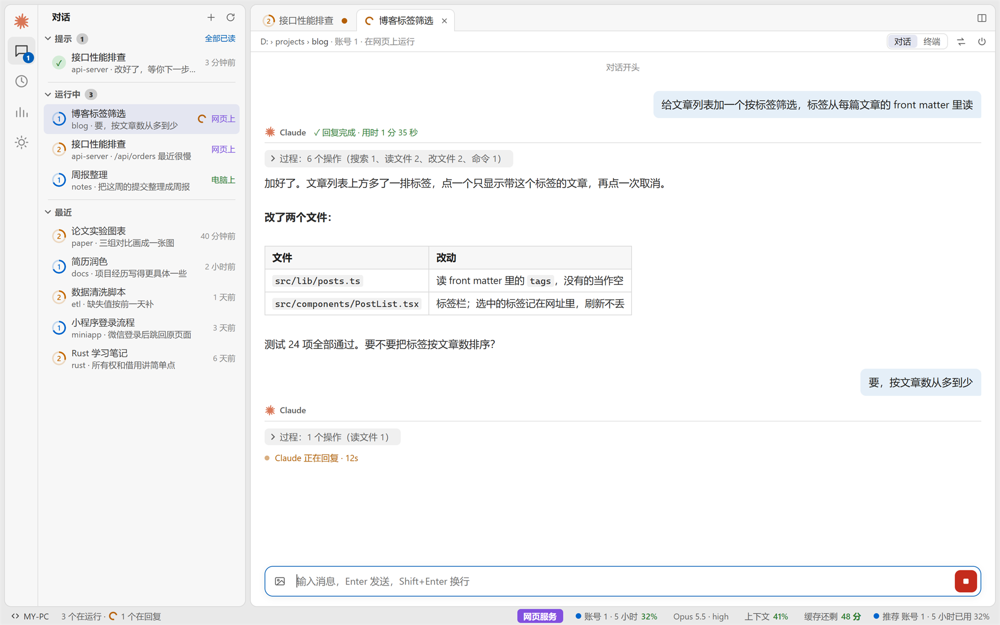
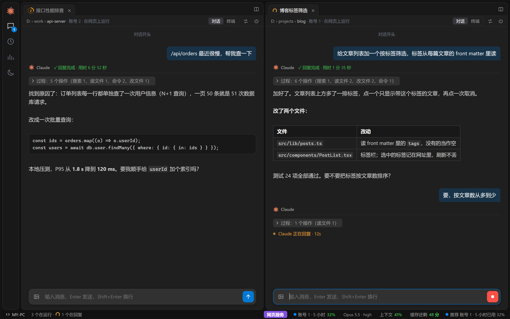
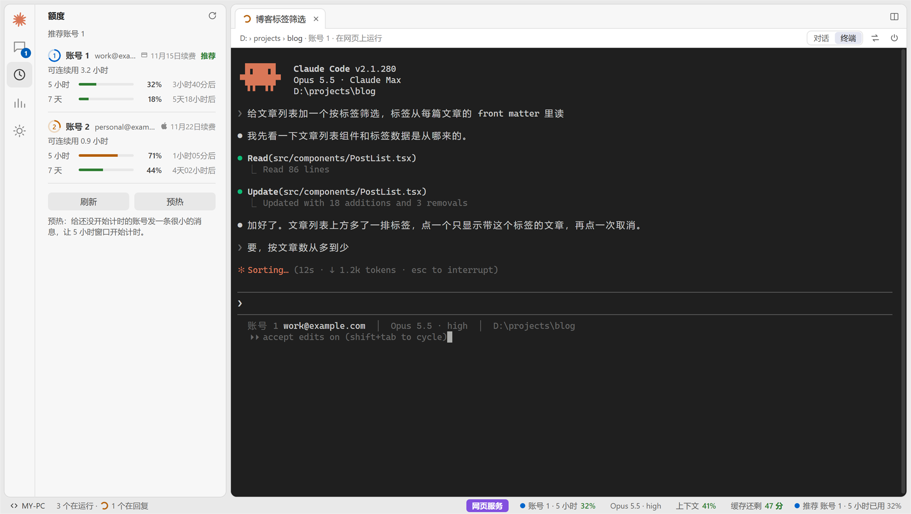
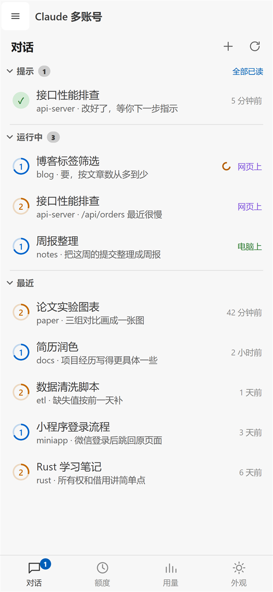
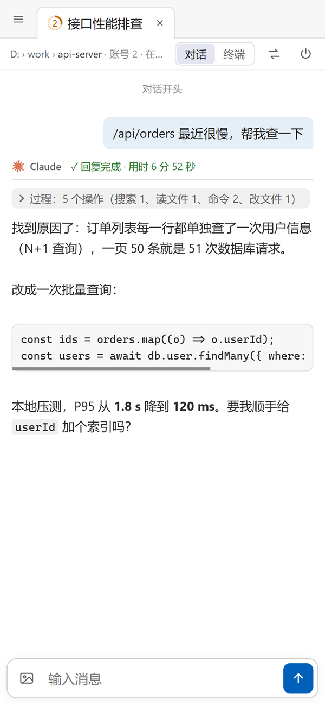
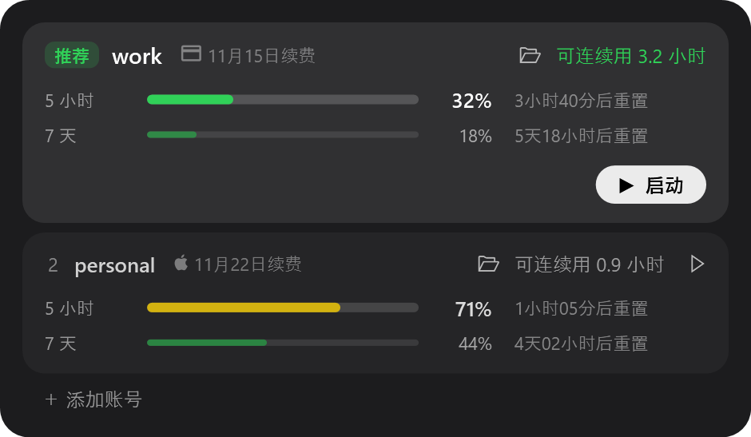

# Claude 多账号（claude-multi）

在一台 Windows 电脑上同时用多个 Claude 订阅账号跑 Claude Code。

- 每个账号一个独立的配置目录，各自登录、各自计额度。设置、技能、插件、MCP、记忆和信任过的文件夹在账号之间共享。
- 屏幕顶上有一个「灵动岛」，可以看各账号额度、启动 Claude、接收「回复完成 / 等你确认」的通知。
- 还有一个网页，电脑和手机都能打开，可以接着用电脑上正在跑的对话。



> 截图里的账号、对话都是演示数据。

## 目录

- [能做什么](#能做什么)
- [截图](#截图)
- [安装](#安装)
- [快速上手](#快速上手)
- [命令一览](#命令一览)
- [灵动岛](#灵动岛)
- [网页](#网页)
- [远程访问（手机、别的电脑）](#远程访问手机别的电脑)
- [数据和安全](#数据和安全)
- [文件说明和测试](#文件说明和测试)

## 能做什么

| 功能 | 说明 |
|---|---|
| 多账号 | `claude-multi new` 登录一个账号，可以加任意多个。启动时选账号，或者直接用推荐的那个。 |
| 额度 | 每个账号 5 小时窗口和 7 天窗口各用了多少、多久后重置、还能连续用多久，并推荐当前最合适的账号。 |
| 预热 | 给还没开始计时的账号发一条很小的消息，让 5 小时窗口提前开始计时，早点重置。 |
| 换账号接着聊 | 一个账号额度快用完时，把对话换到另一个账号继续，记录会一起带过去。 |
| 通知 | Claude 回复完、或者在等你确认权限时，灵动岛和网页都会提示。 |
| 网页 | VS Code 风格：左边是对话列表，右边用书签打开对话，可以左右分栏，同时看多个对话。 |
| 手机 | 同一个网页，手机上是单栏布局，可以添加到主屏幕当 App 用。 |
| 远程 | 通过你自己的服务器（SSH 反向隧道 + nginx HTTPS）在外面访问，用钥匙登录。 |
| 用量统计 | 所有账号的 token 用量，按天、按账号统计，并按 API 价格折算成金额。 |
| GPT | 用 ChatGPT 订阅登录 OpenAI 的 [Codex](https://github.com/openai/codex)，在网页上和 Claude 的对话放在一起用（账号 G1、G2…）。 |

## 截图

**分栏，暗色**



**终端视图和额度面板**：终端视图里看到的和电脑上那个 Claude 窗口一模一样，可以直接打字操作。



**手机**

<table><tr>
<td></td>
<td></td>
</tr></table>

**灵动岛的账号卡片**



## 安装

需要：

- Windows 10 / 11，自带 PowerShell 5.1（灵动岛用到）
- [Node.js](https://nodejs.org/) 20 或更新版本（用 GPT 要 22.13 或更新：读 Codex 的对话记录要用 Node 自带的 SQLite）
- [Claude Code](https://docs.claude.com/en/docs/claude-code)，命令行里能直接运行 `claude`
- 可选：Windows Terminal（灵动岛的「整理窗口」功能要用）
- 可选：[Codex](https://github.com/openai/codex)（`npm i -g @openai/codex`），用 GPT 时要装

**1. 放到固定位置。**程序固定从 `%USERPROFILE%\.claude-multi` 读写数据，所以仓库必须克隆到这个位置：

```bat
git clone <这个仓库的地址> "%USERPROFILE%\.claude-multi"
cd /d "%USERPROFILE%\.claude-multi"
npm install
```

**2. 加一个命令。**在 PATH 里的某个文件夹（比如 `%USERPROFILE%\.local\bin`）新建 `claude-multi.cmd`，内容如下：

```bat
@node "%USERPROFILE%\.claude-multi\claude-multi.js" %*
```

**3. 接上通知和状态栏。**在 `%USERPROFILE%\.claude\settings.json` 里加上下面这些，`<用户名>` 换成你的 Windows 用户名。所有账号共用这一份设置，加一次就行。

```json
{
  "hooks": {
    "Stop": [
      { "hooks": [{ "type": "command", "command": "node \"C:/Users/<用户名>/.claude-multi/claude-multi.js\" notify done" }] }
    ],
    "Notification": [
      { "matcher": "permission_prompt",
        "hooks": [{ "type": "command", "command": "node \"C:/Users/<用户名>/.claude-multi/claude-multi.js\" notify ask" }] }
    ]
  },
  "statusLine": { "type": "command", "command": "node \"C:/Users/<用户名>/.claude-multi/claude-multi.js\" statusline" }
}
```

- 通知钩子：Claude 回复完（`Stop`）或在等你确认权限时（`Notification`），提示会出现在灵动岛和网页上。
- 状态栏：每个终端底部会显示账号、模型和所在文件夹。网页底部状态栏里的模型、上下文用量也是从这里来的。

## 快速上手

```bat
claude-multi new        :: 登录第一个账号（会打开浏览器），想加几个就运行几次
claude-multi usage      :: 看各账号的额度，回车直接用推荐的账号启动
claude-multi            :: 选一个账号，在当前文件夹启动 Claude Code
claude-multi island     :: 打开屏幕顶上的灵动岛
claude-multi web        :: 启动网页服务（http://127.0.0.1:7788）
claude-multi web-link   :: 打印带钥匙的网页链接，用它打开网页
```

`claude-multi` 后面加的参数会原样传给 `claude`，例如 `claude-multi --continue`。

## 命令一览

账号编号（N）就是 `claude-multi list` 里的顺序，从 1 开始。对话 ID 可以用 `claude-multi sessions` 查到。

| 命令 | 作用 |
|---|---|
| `claude-multi [claude 的参数]` | 选择账号后启动 Claude Code |
| `new` | 登录并添加一个账号 |
| `new gpt` | 用 ChatGPT 登录并添加一个 GPT 账号（Codex），编号 G1、G2… |
| `list` | 列出所有账号 |
| `switch` | 改默认账号（不启动 Claude） |
| `usage [--json]` | 各账号额度和推荐账号 |
| `warmup` | 预热：给还没开始计时的账号各发一条很小的消息 |
| `start N [claude 的参数]` | 不弹菜单，直接用账号 N 启动。`start G1` 在当前终端用 GPT 账号 G1 启动 Codex |
| `sessions [--json] [--all]` | 列出所有对话，● 表示正在运行。`--all` 连 GPT 对话一起列 |
| `resume ID N` | 用账号 N 接着一个之前的对话。GPT 对话不用写账号，就在它自己的账号上接着 |
| `swap ID N [--now]` | 把正在运行的对话换到账号 N。默认等 Claude 这一轮答完再换，`--now` 立即换 |
| `attach ID` | 在当前终端接上一个在网页服务里运行的对话，两边看到同一个画面 |
| `chat look\|wait\|say\|pick\|new …` | 管家用的：看一个对话（含它正在问的选择题）、等它答完或等到某个时间、给它发消息、替你选一项、在后台新开对话（`new … --gpt` 开 GPT 对话）。不带参数运行 `chat` 看用法 |
| `rename ID 名字` | 给没在运行的对话改名 |
| `delete ID` | 把没在运行的对话移到回收站。GPT 对话是归档（`codex unarchive` 能找回） |
| `remove N` | 移除账号 N。它的文件夹移到回收站，有对话正在用它时不让移除。`remove G1` 移除 GPT 账号 G1（有 Codex 在它上面运行时同样不让移除） |
| `tokens [--json]` | token 用量和按 API 价格折算的金额 |
| `renew N 月-日` / `renew N auto` | 手动记下账号 N 的续费日，或改回自动推算 |
| `island` | 打开灵动岛（已经开着就不会再开一个） |
| `chats [arrange\|tokens]` | 打开灵动岛的对话窗口、窗口整理面板或用量页 |
| `web` | 启动网页服务 |
| `web-link [new]` | 打印网页链接。加 `new` 会换一把新钥匙，以前登录过的浏览器都要重新登录（已经打开着的终端画面也会在 15 秒内断开） |
| `wt-bind` | 给 Windows Terminal 加上灵动岛整理窗口要用的快捷键 |
| `notify done\|ask`、`notes`、`statusline` | 给钩子、灵动岛和状态栏内部调用的，不用手动运行 |

## 灵动岛

`claude-multi island` 会在屏幕顶部中间放一个小胶囊。平时显示推荐账号的名字、它的 5 小时用量和还能连续用多久，后面是其他账号的编号和 5 小时用量。不想要它的话，在网页的「设置 → 电脑 → 桌面灵动岛」里关掉：灵动岛马上关闭，之后不会再自己出来（对话回复完、开机都不会），网页和手机的提示照常，开机时网页服务也照样会启动。

点开后：

- **账号卡片**：每个账号的 5 小时、7 天用量，重置时间，还能连续用多久，以及续费日期。点「启动」用这个账号开一个 Claude。文件夹图标打开这个账号的配置目录。鼠标移到卡片上会出现垃圾桶，点了再确认才会移除。
- **＋ 添加账号**：打开一个终端，运行 `claude-multi new`。
- **通知**：Claude 回复完、或者在等你确认时，灵动岛会弹出来，点一下跳到那个窗口。
- **对话窗口**：所有对话按时间排列，可以接着聊、换账号、改名、删除。
- **整理窗口**：把多个 Claude 终端排好。先运行一次 `claude-multi wt-bind`。

## 网页

`claude-multi web` 启动网页服务。它只监听本机 `127.0.0.1:7788`，外面要访问需要按下一节配置。用 `claude-multi web-link` 打印的链接打开一次，浏览器会记住钥匙一年。

**布局**（电脑上）

- 最左一列图标：对话、额度、用量，最下面的齿轮弹出设置窗口：主题（跟随系统 / 亮色 / 暗色）和通知。再点一下当前的图标，列表就收起来。
- 点列表里的对话，它会作为书签在右边打开。打开多个时点书签切换，点 × 关闭，鼠标中键也能关。
- **分栏**：书签栏右上角的按钮会把当前书签挪到右边新的一栏。也可以点列表行右侧的按钮、按住 Ctrl 点击，或者把书签拖到右侧区域的左右边缘停靠。最多三栏，中间的分隔线可以拖动改宽度。
- 打开的书签和分栏刷新后还在。
- **搜索对话**：按 Ctrl+K，或者点列表上方的放大镜。标题、最后一句话、文件夹都能搜，空格隔开几个词就是都要有。方向键选，回车打开，Ctrl+回车在右侧打开。在终端视图里 Ctrl+K 还是给 Claude 的。
- 鼠标移到列表里的文件夹上，右边会出现 ＋，点了直接用推荐的账号在这个文件夹开一个新对话（手机上 ＋ 一直显示）。
- 在列表里的对话上点右键（手机上按住半秒）：在右侧打开、重命名、换账号继续、删除。删除是移到电脑的回收站，可以找回。正在运行的对话不能在这里重命名或删除：重命名在对话里发 `/rename 新名字`，删除要先结束它。

**GPT 对话**（Codex）

- 先在电脑上运行 `claude-multi new gpt`：会打开浏览器用 ChatGPT 登录，用的是你的订阅额度，不用 API key。每个 GPT 账号有自己的目录（`accounts\gpt-…`），你现在 `~/.codex` 里的设置（模型、MCP、信任过的文件夹、AGENTS.md）会复制一份进去；`~/.codex` 本身和里面原来的对话不动，也不显示在这里。
- 新账号第一次启动 Codex 时，它可能会先问你一个问题，比如「Hooks need review」（你装的插件带的 hook，要在这个账号里再信任一次）。在网页上开一个 GPT 对话，切到「终端」回答一次，这个账号以后就不会再问。没回答之前，管家开 GPT 对话会告诉你去处理，不会把消息打进那个界面。
- 在终端里也能用：运行 `claude-multi`，选账号的菜单里有 G1、G2（输入 `g1`）；或者直接 `claude-multi start G1`。`claude-multi resume <对话编号>` 接着一个 GPT 对话。在终端里跑的 GPT 对话回复完也会提示，网页列表里标「电脑上」，点开和 Claude 的一样：「对话」看记录，「终端」同步电脑上那个窗口，也能在网页上打字。
- 有了 GPT 账号后，「新对话」上面多一个「Claude / GPT」切换。列表里两种对话按文件夹放在一起，GPT 账号的圆环写着 G1、G2，列表顶部可以只看 Claude 或只看 GPT。
- 「对话」视图和「终端」视图都能用：「对话」显示你的消息、它的回答和折叠起来的「过程」；「终端」就是 Codex 的界面本身。在新文件夹里开 GPT 对话时，这个账号会自动信任那个文件夹（写在它自己的 config.toml 里）。
- 「额度」里有 GPT 账号的用量（各窗口用了多少、多久后重置），在它上面回复过一次后才读得到。
- 右键菜单里 GPT 对话的「删除」是**归档**（Codex 自己的功能，用 `codex unarchive` 能找回）；GPT 对话暂时不能在这里改名，也不能换账号。
- 发图片时，GPT 对话收到的是图片的路径。
- 网页服务启动的 GPT 对话回复完、要权限确认时，和 Claude 的一样会提示（灵动岛、网页、手机）。这些对话用的是 claude-multi 的通知，不用账号配置里从 `~/.codex` 复制来的那条 `notify`（那条是 Codex 桌面版自己的）。
- 管家也能用 GPT 对话：看、发消息、派工单，新开时加 `--gpt`（`chat new … --gpt`、`ticket give … --gpt`）。默认还是用 Claude，你点名要 GPT 它才用。
- 灵动岛也有 GPT：展开后上面多一个「Claude / GPT」切换，GPT 那边是各个 GPT 账号的额度卡片（只有 GPT 账号时直接显示它们），卡片上的按钮用这个账号在选的文件夹里启动 Codex，下面有「＋ 添加 GPT 账号」。对话窗口里 GPT 对话和 Claude 的列在一起：没在运行的点一下在终端里接着聊，在运行的切到它的窗口，网页上运行的在网页上打开；可以归档，不能改名、换账号。「新建对话」可以选 G1、G2。GPT 对话的提示点一下，会找到它的 Codex 窗口。
- 现在还没有：GPT 的选择题和权限确认卡片（要在「终端」里操作，管家也替不了你选）。网页服务重启后，在里面运行的 GPT 对话会结束，之后可以在列表里点开接着聊。

**对话里**

- 「对话」视图只显示你的消息和 Claude 的回答。中间的工具操作和过渡的话收成一行「过程」，点开能看全部。
- 回答里的数学公式（`$…$`、`$$…$$`、`\(…\)`、`\[…\]`）用 [KaTeX](https://katex.org/) 渲染，从本机加载，不依赖外网。
- 「终端」视图就是 Claude 窗口本身，可以直接打字操作。
- 发图片：点输入框左边的图片按钮，也可以粘贴截图或拖进来。
- 发送按钮是一个箭头。Claude 在回复时它变成红色方块，点了就让 Claude 停下。如果那条消息还没开始执行，它会回到输入框，可以改了再发。
- Claude 让你选择时（比如「信任这个文件夹吗」、权限确认），选项会显示成按钮。输入框是空的时候，也可以直接按选项前面的数字键选，和在终端里一样。
- 很长的消息（比如粘贴进来的一大段，或者超过两万字的回答）只显示前 10 行，点「展开全部」看全文，复制拿到的也是全文。
- 你的消息和上一条隔了 5 分钟以上时，上面会显示时间：今天的只写几点几分，前面还有「昨天」「11月3日」这样的日期。
- 列表里账号编号外面的圆环表示这个账号的 5 小时额度还剩多少，鼠标停在上面能看到具体百分比和重置时间。
- 列表里对话右边的橙点表示它在等你，绿点表示答完了你还没看；收起来的文件夹也会带着点。网页标题前面的 (N) 是还没看的提示数。
- 回复里的网址可以直接点开。代码块右上角、每段回答下面有复制按钮（电脑上鼠标移上去才出现），回答复制的是 Claude 写的原文。
- 往上翻着看的时候，输入框上面有「↓ 回到最新」；下面来了新回复，它变成蓝色的「↓ 新消息」。
- 输入框里还没发的字按对话记在这个浏览器里，刷新、关掉书签再打开都还在。
- 底部状态栏显示当前对话：在电脑窗口还是网页服务里运行、账号额度、模型和思考强度、上下文用了多少、提示缓存还剩几分钟。

**手机上**

- 只显示一栏。左上角 ☰ 打开列表，底部切换对话、额度、用量、设置。
- 终端视图下方有一排按键：Esc、Tab、方向键、Ctrl+C 等。
- 连不上电脑时（电脑关机、断网，或者网页服务没开），顶部会出现红色的「连不上电脑，正在重试…」，连上后自己消失。
- 管家模式下点顶部那一行，操作台（任务、今天做了、对话、账号）会从底部弹出来，点外面收起。
- 在 Safari 里点「分享 → 添加到主屏幕」，之后就能像 App 一样全屏打开。
- 手机通知：从主屏幕打开，点底部的「设置」，打开「通知」并允许。对话回复完、等你确认时，手机会弹出通知，点一下直接打开那个对话。你正在网页上看着的对话不会推送。需要 iOS 16.4 以上。
- 不想要 iOS 给网页通知加的「from …」那一行：装开源的 [Bark](https://github.com/Finb/Bark)，把它首页的地址写进 `%USERPROFILE%\.claude-multi\bark.json`：`{"url": "https://api.day.app/<你的 key>"}`（这个文件不进仓库，key 别外传）。有这个文件时通知只走 Bark，不再走网页推送；点通知在 Safari 里打开那个对话。改完重启网页服务。

## 远程访问（手机、别的电脑）

网页服务只在电脑本机监听。要在外面访问，需要一台有公网 IP 的服务器做中转：

```
手机浏览器 ──HTTPS──▶ 服务器 nginx :8443 ──▶ /run/claude-multi.sock ══SSH 反向隧道══▶ 电脑 127.0.0.1:7788
```

整条链路是电脑主动连服务器，所以电脑不需要公网 IP，也不用在路由器上开端口。断线后会自动重连。

**1. 电脑能免密 SSH 登录服务器。**在 `~/.ssh/config` 里给服务器起一个名字，比如 `myserver`，并配好密钥登录。

**2. 写服务器信息。**在 `%USERPROFILE%\.claude-multi\` 里新建 `tunnel.json`（这个文件不进仓库）：

```json
{ "ssh": "myserver", "url": "https://你的服务器地址:8443" }
```

`ssh` 是第 1 步在 `~/.ssh/config` 里起的名字，`url` 是手机上打开的地址。没有这个文件时，网页服务只在本机 `http://127.0.0.1:7788` 能打开，不连服务器。

服务器上登录用的账号要有正常的 shell，并且允许分配终端：隧道会在服务器上开一个会话，运行 `sleep infinity` 占着连接，这样两端才会立即发送小数据包，打字不卡。服务器要是 Linux。

**3. 服务器上的 sshd。**新建 `/etc/ssh/sshd_config.d/60-claude-multi.conf`，然后运行 `systemctl reload ssh`：

```
ClientAliveInterval 5
ClientAliveCountMax 3
StreamLocalBindUnlink yes
StreamLocalBindMask 0111
```

**4. 服务器上的 nginx。**证书可以用 Let's Encrypt，没有域名也能给 IP 签证书。别忘了在防火墙和云服务商的安全组里放行 8443 端口。

```nginx
upstream claude_multi {
    server unix:/run/claude-multi.sock;
    keepalive 8;                         # 复用隧道里的连接：每次新开要多 100 毫秒左右，打字会卡
    keepalive_timeout 4s;                # 比网页服务自己的 5 秒短
}
server {
    listen 8443 ssl;
    server_name 你的服务器地址;
    ssl_certificate     /etc/letsencrypt/live/你的服务器地址/fullchain.pem;
    ssl_certificate_key /etc/letsencrypt/live/你的服务器地址/privkey.pem;
    ssl_protocols TLSv1.2 TLSv1.3;
    server_tokens off;
    client_max_body_size 30m;            # 发图片
    location / {
        proxy_pass http://claude_multi;
        proxy_http_version 1.1;
        proxy_set_header Host $http_host;
        proxy_set_header Connection "";
        proxy_buffering off;             # 终端画面是实时推送的
        proxy_read_timeout 1h;
        proxy_intercept_errors on;
        error_page 502 504 = @away;
    }
    location @away { default_type "text/plain; charset=utf-8"; return 503 "电脑那边没连上（关机、断网，或网页服务没开）。\n"; }
}
```

**5. 启动网页服务**（`claude-multi web`），它会自己建好隧道。然后用 `claude-multi web-link` 打印的链接在手机上打开。

> 如果电脑开着 Clash 之类的 TUN 模式代理，记得让到服务器的连接走直连。

## 数据和安全

- 每个账号的登录凭证只在它自己的 `accounts/<id>/` 目录里。`profiles.json` 和日志不保存任何令牌、cookie 或登录链接。
- 仓库只收代码，`.gitignore` 用的是白名单。账号目录、对话记录、网页钥匙、上传的图片都不会进仓库。
- 网页钥匙保存在 `web-key`，浏览器用 HttpOnly cookie 记住它。比较钥匙时用的是防计时攻击的方式，改动类的请求只接受同一网站发来的。
- 删除对话、移除账号都是移到 Windows 回收站，可以找回。

## 文件说明和测试

| 文件 | 内容 |
|---|---|
| `claude-multi.js` | 命令行和网页服务 |
| `island.ps1` | 灵动岛（WPF）。必须保存为带 BOM 的 UTF-8，否则 PowerShell 5.1 会读错中文 |
| `console-bridge.ps1` | 读取电脑上 Claude 窗口的画面并转发按键，网页的终端视图靠它 |
| `web.html` | 网页，单个文件，每次刷新直接读取，改完不用重启服务 |
| `screen.js` | 从 Claude 的终端画面认出「正在回复」和选择题，网页和管家的命令共用 |
| `butler\` | 管家的工作文件夹：`CLAUDE.md` 是它的规矩，模型设成 Sonnet |
| `tickets.json` | 管家的工单（用户的原话、交给了哪个对话、它的汇报和每轮结束的时间），只由网页服务写，不进 git |
| `claude-multi.test.js` | 测试 |
| `web.test.js` | 隔离浏览器中的网页交互、键盘和手机布局测试 |
| `island.test.ps1` | 隔离 WPF 窗口中的小工作区、多账号与通知滚动测试 |

运行测试：

```bat
node claude-multi.test.js
```

每一项通过会打印一行 `… ok`。测试在临时目录里另建一个用户目录运行，不读也不改你真正的 `.claude-multi`（账号列表、正在用的对话都不受影响）。

主测试还覆盖并发新建的 PID 绑定、快捷交代拒发保留、电脑终端清空记录、跨会话草稿与附件隔离，以及异步管道写入失败。新终端没有返回 PID 时会明确报错，避免工单绑定到附近启动的另一个对话。

Windows 上可以再运行界面测试：

```bat
node web.test.js
powershell -NoProfile -STA -File island.test.ps1
```

浏览器测试使用 Chrome 或 Edge 的独立临时配置及模拟接口，也可用 `BROWSER_EXE` 指定 Chromium 可执行文件。WPF 测试只加载窗口布局和尺寸约束，在不可见窗口里模拟小工作区，不启动灵动岛的后台逻辑。两者都不连接正在使用的网页服务。

改了 `claude-multi.js` 之后要重启网页服务才会生效。重启会关掉在网页服务里运行的对话，对话记录不会丢，之后可以接着聊。
